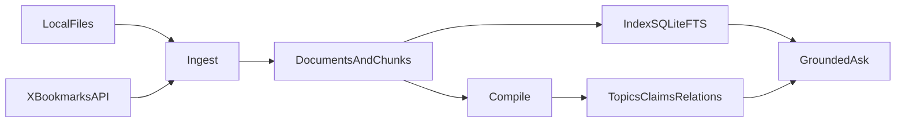
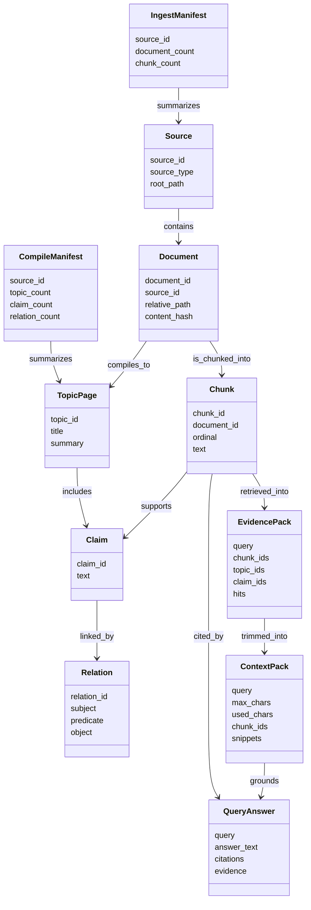
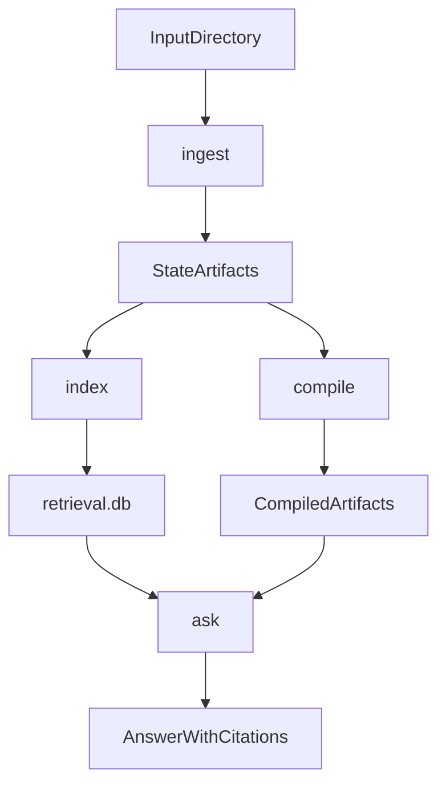
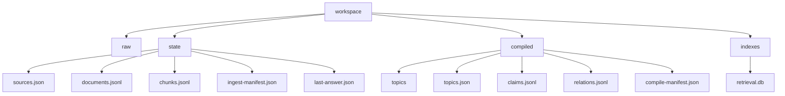

# Knowledge Compiler

`knowledge-compiler` is a local-first Python project that turns source material
into inspectable knowledge artifacts and grounded query workflows. The current
implementation already covers a real end-to-end slice: it ingests local files,
normalizes them into deterministic chunks, compiles those chunks into Markdown
topic artifacts, indexes the chunks with `SQLite FTS`, and answers grounded
questions with citations.

This file is the general guide to the project. It is meant to explain what the
project is, why it exists, how it is structured, and what it currently does. If
you want the practical user booklet, examples, and day-to-day command guidance,
use `practical-guide.md`.

The codebase targets modern `Python 3.14`.

## Why This Project Exists

A lot of LLM tooling treats source material as temporary prompt context. That is
useful for quick experiments, but it breaks down as soon as you want reuse,
traceability, or confidence. The other common failure mode is even worse: the
system produces plausible answers, but nobody can easily tell which source
material actually supports them.

This project is trying to solve that in a different way. Instead of building a
chat wrapper around files and connectors, it is building a knowledge
compilation pipeline. The idea is simple: ingest raw knowledge, preserve its
provenance, create stable intermediate artifacts, build retrieval on top of
those artifacts, and only then answer questions in a grounded way.

That is why the current design is intentionally `local-first`, `artifact-first`,
`grounded`, and `inspectable`.

## What The Current Slice Is Trying To Prove

The present code is the first usable `MVP` slice. Its job is not to be feature
complete. Its job is to prove that the core loop is worth building on.

What we want to validate right now is whether we can take local knowledge files,
store a reproducible normalized representation, compile readable outputs from
them, and query the result using chunk-level evidence rather than vague
summaries. At this stage, simplicity and traceability matter more than
breadth.

## Engineering And Writing Principles

The project follows a few strong defaults. On the engineering side, the code is
guided by `Pragmatic Programmer` and `SOLID`: slices should be small and
working, orchestration should stay thin, responsibilities should stay narrow,
and abstractions should appear only when the code has actually earned them.

The code also leans on `Pydantic` for domain contracts and persisted artifacts,
because explicit models make the system easier to reason about, test, and
inspect.

There is also a communication principle here: documentation and explanations
should read like something written for a human being, not like a checklist dump.
When lists are useful, they should still explain the point clearly. The goal is
to make both the code and the documentation understandable without forcing the
reader to reconstruct the intent from fragments.

## What Exists Today

Today the repo includes the project scaffolding, a typed domain model, local
ingestion for `md`, `txt`, and `html`/`htm` (body text extracted with the standard
library), optional ingestion of posts you have **saved on X**
(bookmarks) through the official API when you supply an OAuth 2.0 user access
token, deterministic normalization and chunking, a basic
compile pipeline that emits Markdown topic pages, lightweight claims and
relations artifacts, local chunk indexing with `SQLite FTS`, and a grounded
`ask` command over indexed chunk evidence. It also includes inspection and trace
commands so the current artifact flow is easier to understand and debug. It now
also has an explicit retrieval step that assembles an `EvidencePack`, so the
retrieval result can be inspected directly before it is turned into an answer.
The repo includes project skills for the workflows that already exist.

The CLI already exposes the full local workflow. `knowledge-compiler ingest
<input-dir>` reads and normalizes local source material.
`knowledge-compiler ingest-x-bookmarks` pulls your X bookmarks over HTTPS and
feeds them through the same normalization and chunking path. By default each
ingest run **replaces** the normalized bundle; pass **`--merge`** on `ingest` or
`ingest-x-bookmarks` to add or refresh one source while keeping others.
`knowledge-compiler
compile` converts that normalized state into compiled topic artifacts, and
`knowledge-compiler index` rebuilds the local chunk search index.

Once the corpus is prepared, the query-time commands take over.
`knowledge-compiler retrieve "<query>"` assembles the current `EvidencePack`
without forcing answer generation. `knowledge-compiler context "<query>"`
turns that retrieval result into a bounded `ContextPack`, which represents the
selected evidence surface. `knowledge-compiler ask "<question>"` performs the
grounded lookup and returns an answer with citations. If you want to inspect the
state directly, `knowledge-compiler inspect ...` lets you inspect the current
workspace, individual topics, and individual chunks, while `knowledge-compiler
trace` shows the last grounded answer together with the cited chunks behind it.
There is now also a lightweight `knowledge-compiler runs` command, which shows
the recent local query-time history for `retrieve`, `context`, and `ask`.

## Current Architecture

The current slice is intentionally simple:



The important structural idea is that the system is layered even though it is
still small. `schemas` defines the typed domain contracts and manifests.
`connectors` is where source adapters live. `ingestion` handles discovery,
normalization, and chunking. `compile` turns normalized state into derived
knowledge artifacts. `retrieval` owns the local search index. `services`
contains the use cases that the CLI calls. `storage` persists the workspace
state. `cli.py` is deliberately thin and exists only to wire user input into
the services.

The current evidence model matters a lot. Chunks are the canonical evidence
unit. Compiled topic pages are derived artifacts. Answers are expected to cite
chunks, not merely summaries. That is what keeps the system grounded and
inspectable.

## Domain Concepts

The core concepts are already visible in the code and artifacts. A `Source`
describes the input source being ingested. A `Document` represents a normalized
source file. A `Chunk` is the canonical evidence unit and carries stable
provenance. A `TopicPage` is a compiled Markdown artifact. A `Claim` is a
simple extracted statement linked to evidence. A `Relation` is a lightweight
connection between a topic and a claim. An `EvidencePack` is the explicit
retrieval result for a query: it contains the chunk hits and the related topics
and claims that retrieval surfaced. A `ContextPack` is the bounded subset of
that evidence that the answering step actually works with. An `IngestManifest`
and a `CompileManifest` summarize what those phases produced. A `QueryAnswer`
holds a grounded answer together with citations and evidence hits.

The relationships between those concepts are easier to understand visually:



## How The Current Workflow Works



When you run `ingest`, the project walks a local directory, reads the supported
files, normalizes their text, chunks the content deterministically, and writes
typed artifacts into `workspace/state/`. Supported file types are `md`, `txt`, and `html`/`htm` (tags and script/style
blocks are stripped; visible text is normalized like other files).

When you run `compile`, the project loads the normalized documents and chunks,
groups chunks by document, creates one Markdown topic page per document, emits
simple claims and relations, and writes the result into `workspace/compiled/`.
This is intentionally conservative. It is a basic compile pass, not a clustering
or ontology system yet.

When you run `index`, the project loads the chunks from
`workspace/state/chunks.jsonl`, rebuilds a local `SQLite FTS5` index, and
stores that database under `workspace/indexes/retrieval.db`. The index is
meant to be disposable and rebuildable.

When you run `retrieve`, the project searches indexed chunks, assembles an
explicit `EvidencePack`, and stores that result as the current retrieval state.
That pack includes the chunk hits together with the related topics and claims
that overlap with the retrieved chunk IDs.

When you run `context`, the project takes that retrieval result and applies a
simple character budget to build a `ContextPack`. This is the selected evidence
surface that later answer generation can consume.

When you run `ask`, the project now builds on that full chain. It retrieves
evidence, builds a bounded context pack, extracts the most relevant sentences
from that selected context, and returns a grounded answer with citations. If no
evidence is found, it says so explicitly instead of pretending confidence.

## Quick Start

Install dependencies first:

```bash
uv sync
```

Then run the full local workflow:

```bash
uv run knowledge-compiler ingest tests/fixtures/input
uv run knowledge-compiler compile
uv run knowledge-compiler index
uv run knowledge-compiler retrieve "deterministic chunking"
uv run knowledge-compiler context "deterministic chunking"
uv run knowledge-compiler ask "deterministic chunking"
```

The output shape is intentionally simple:

```text
Deterministic chunking keeps citations stable

Citations:
- doc-...-chunk-0000 (sample.md:1-7)
```

## CLI Usage

### Ingest

Use `ingest` when you want to scan a local directory and create normalized state
artifacts from it.

```bash
uv run knowledge-compiler ingest <input-dir>
```

Use **`--merge`** to keep documents from other sources already in
`workspace/state/` and only replace rows for this connector’s `source_id` (for
example local notes plus bookmarks in one workspace).

A concrete example looks like this:

```bash
uv run knowledge-compiler ingest tests/fixtures/input
```

This command recursively scans the directory, ingests supported files, and
writes the normalized source state under `workspace/state/`.

### Ingest X bookmarks

Use `ingest-x-bookmarks` when you want your **saved posts on X** in the corpus
without downloading the heavy account archive export. The tool calls X API v2
`GET /2/users/:id/bookmarks` with **user context** authentication, turns each
bookmark into a small text document (post text, author metadata, link), and runs
the usual chunking pipeline.

**Text length and cropping.** Bookmarks requests include **`tweet.fields=…,note_tweet`**.
When X returns a **`note_tweet`** object with `text`, that string is used as the
post body (long notes); otherwise the regular `text` field is used. This project
does not shorten either string. If both are missing or truncated by the platform,
there is nothing further to fetch at this layer. Separately,
the **topic title** derived from a bookmark is capped at about **80 characters**
for stable filenames and manifests; full text remains in chunks. After compile,
the **topic summary** in artifacts is a short excerpt (~240 characters) from the
first chunk, not a full copy of the post. At query time, **`context`** and
**`ask`** only show portions that fit their budgets.

**Authentication.** Bookmarks are private. X’s API responds with **HTTP 403**
if you call `GET /2/users/:id/bookmarks` with **OAuth 1.0a**; only **OAuth 2.0
User Context** (a user access token) is accepted. The read-only **application
Bearer** from the developer portal also cannot call `/users/me` or bookmarks.

Set **`KNOWLEDGE_COMPILER_X_ACCESS_TOKEN`** to a user access token from the
authorization-code + **PKCE** flow, with scopes **`tweet.read`**,
**`users.read`**, and **`bookmark.read`**. Consumer key and secret are used when
you configure that OAuth 2 app in the portal; this CLI does not send them on
bookmark requests—only the Bearer user token.

```bash
# Put variables in .env or export them, then:
uv run knowledge-compiler ingest-x-bookmarks
```

Optional flags: `--max-pages` stops after N API pages (useful for tests or large
libraries), `--page-size` controls page size up to 100 (the API maximum), and
**`--merge`** combines bookmark documents with an existing workspace from another
source instead of wiping it.

Access to the bookmarks endpoints also depends on your X developer project
capabilities and current platform rules, which change independently of this
repo.

Without **`--merge`**, this command **replaces** the normalized bundle in
`workspace/state/`, the same default as folder `ingest`. With **`--merge`**, only
bookmark rows are refreshed and other sources stay in place; then run `compile`
and `index` over the combined corpus.

### Compile

Use `compile` after ingesting content and you want readable knowledge artifacts.

```bash
uv run knowledge-compiler compile
```

This command reads the normalized state and writes compiled Markdown topics
together with compile metadata and relation artifacts. It also runs a
**deterministic lexical theme pass**: topics are grouped when their titles and
summaries share enough keywords (Jaccard-style overlap, no embeddings). Each
topic gets `theme_id` / `theme_label` in `topics.json`, topic Markdown includes a
**Theme** section when present, and `compile-manifest.json` lists `themes` with
member topic ids. Themes are coarse and explainable, not semantic clusters.

It also adds **cross-topic relations** when two different topics’ titles and
summaries overlap lexically (another Jaccard pass, capped per topic). Those
edges use the predicate `lexically_related_to` and appear in `relations.jsonl`
with ids like `xref-<topic-a>-to-<topic-b>`. Counts are summarized in
`compile-manifest.json` as `lexical_cross_topic_links`.

### Index

Use `index` whenever the chunk state changes and you want grounded retrieval to
reflect the current corpus.

```bash
uv run knowledge-compiler index
```

This command rebuilds the local search index from chunks.

### Ask

Use `ask` when you want to query the indexed corpus and get a grounded answer
with citations.

```bash
uv run knowledge-compiler ask "<question>"
```

For example:

```bash
uv run knowledge-compiler ask "What does deterministic chunking help with?"
```

You can also reduce the number of retrieved results if you want a smaller answer
surface:

```bash
uv run knowledge-compiler ask "deterministic chunking" --limit 3
```

Retrieval tuning (also on `context` and `retrieve`): `--match and|or` chooses
whether all query terms must match (default **and**) or any term may match
(**or**). `--candidate-pool N` widens how many raw FTS hits are considered
before diversification (default scales with `--limit`). `--max-per-document K`
caps how many chunks from the same source document appear in the final ranked
list (default **2**), then the tool may backfill if the list is still short.

If the index is missing, build it first:

```bash
uv run knowledge-compiler index
```

### Retrieve

Use `retrieve` when you want to inspect what the system found before turning it
into an answer.

```bash
uv run knowledge-compiler retrieve "<query>"
```

For example:

```bash
uv run knowledge-compiler retrieve "deterministic chunking"
```

This command shows the current query, retrieval settings (match mode, how many
candidates were scored, per-document cap), how many chunks were retrieved, how
many related topics and claims overlap, and the ranked hit snippets.

The search layer turns your text into word tokens using the same Unicode-aware
rules everywhere retrieval, bounded context, and the simple grounded answer use.
By default the remaining terms are combined with **AND** in FTS; use `--match or`
for **OR**. After FTS, hits are **reranked** with BM25 score plus a small bonus
for lexical overlap with the query, then **diversified** so one loud document
does not occupy the whole list unless you raise `--max-per-document` or the pool
is exhausted. Sentence selection for context uses the same token shape on the
snippet side as the query.

### Context

Use `context` when you want to inspect the bounded evidence that would actually
feed answer generation.

```bash
uv run knowledge-compiler context "<query>"
```

For example:

```bash
uv run knowledge-compiler context "deterministic chunking" --limit 3 --max-chars 800
```

This command retrieves evidence, applies a character budget, and writes the
selected context snippets to the current context state. It can include **more
than one snippet** when the budget allows (strategy `query-aware-multi-snippet-v2`).
The CLI also prints a rough **`estimated_input_tokens`** figure (~4 characters
per token) so you can reason about model context windows alongside the character
budget.

### Inspect

Use `inspect` when you want to understand what the current workspace contains
without opening the artifact files manually.

To inspect the overall workspace state, run:

```bash
uv run knowledge-compiler inspect workspace
```

To inspect one compiled topic, run:

```bash
uv run knowledge-compiler inspect topic <topic-id>
```

To inspect one canonical evidence chunk, run:

```bash
uv run knowledge-compiler inspect chunk <chunk-id>
```

`inspect workspace` also reports how many **themes** the last compile produced
(lexical clusters in `compile-manifest.json`).

This is useful when you want to connect the CLI output back to the stored
artifacts and source ranges.

### Trace

Use `trace` when you want to see how a grounded `ask` answer maps back to cited
chunks. With no options it uses `workspace/state/last-answer.json` (the most
recent `ask`).

```bash
uv run knowledge-compiler trace
```

To re-open an older `ask` after further queries, copy the **run id** from
`runs` (first column) and pass:

```bash
uv run knowledge-compiler trace --run ask-<prefix>
```

The id can be abbreviated while it stays unique among recorded `ask` runs.

### Runs

Use `runs` when you want a quick view of recent `retrieve`, `context`, and `ask`
activity without opening `workspace/state/query-runs.jsonl` directly.

```bash
uv run knowledge-compiler runs
```

Each line starts with a **run id**, then the command, query, hit counts, and
chunk counts. When the compile graph associates topics or claims with those
chunks, the line also includes `topics` and `claims` counts. `context` runs show
`context_chars` after the character budget was applied; `ask` runs reuse that
field for the bounded context that fed the answer, and include a short answer
preview. Newer `ask` runs also store full answer text and citation chunk ids so
`trace --run` can replay evidence.

## Project Root

Every command treats one directory as the **project root**: that is where the
tool expects the `workspace/` tree to live. By default the root is simply the
current working directory when you invoke the CLI, which matches the common case
of `cd` into your notes repository and running commands there.

If you need to run the CLI from somewhere else while keeping the same corpus,
you have two levers. Passing `--project-root` / `-p` on the main command (before
the subcommand) wins for that invocation—for example
`knowledge-compiler -p /path/to/repo ingest ./notes`. Otherwise, set the
environment variable `KNOWLEDGE_COMPILER_ROOT` to the project directory. If
neither is set, the current working directory is used. Precedence is:
`--project-root`, then `KNOWLEDGE_COMPILER_ROOT`, then cwd.

On startup, the CLI loads a file named `.env` from that same resolved project
root (or from the current directory when no root is fixed yet), using
`python-dotenv`. Variables that are **already** set in your shell are **not**
overwritten. Copy `.env.example` to `.env` for a template; `.env` is listed in
`.gitignore` so secrets stay local.

## Workspace Layout

Artifacts are stored under `workspace/`.



The directory layout is straightforward. `workspace/raw/` exists for raw input
storage as the project grows. `workspace/state/` holds the normalized source
state. `workspace/compiled/` holds derived knowledge artifacts. `workspace/indexes/`
holds rebuildable retrieval indexes.

After `ingest`, you should expect to see `sources.json`, `documents.jsonl`,
`chunks.jsonl`, and `ingest-manifest.json` under `workspace/state/`. Those
files represent the normalized source state.

After `compile`, you should expect `topics/<topic>.md`, `topics.json`,
`claims.jsonl`, `relations.jsonl`, and `compile-manifest.json` under
`workspace/compiled/`. The manifest includes optional **`themes`** entries
(lexical clusters) and **`theme_clustering`** identifies the algorithm version.
Topic records carry **`theme_id`** and **`theme_label`** when clustering applies.

After `index`, you should expect `workspace/indexes/retrieval.db`, which is the
local full-text index over chunks.

After `ask`, the project also writes `workspace/state/last-answer.json`, which
stores the last grounded answer returned by the current query flow.

The query-time workflow also appends local history records to
`workspace/state/query-runs.jsonl`, which stores recent `retrieve`, `context`,
and `ask` runs.

After `retrieve`, the project writes `workspace/state/last-evidence-pack.json`,
which stores the most recent explicit retrieval result.

After `context`, the project writes `workspace/state/last-context-pack.json`,
which stores the most recent bounded context selection.

## Skills

The repo includes project skills for the workflows that already exist. One skill
helps run the local ingest, compile, and index sequence. Another helps run the
grounded question flow over the current workspace. A third skill helps inspect
the generated artifacts and trace the last answer back to source evidence. A
fourth skill helps retrieve the current evidence pack without forcing answer
generation. A fifth skill helps build the bounded context pack that sits
between retrieval and answer generation. A sixth skill helps review recent query
history. These skills are operational helpers around the implemented commands;
they are not a second product layer.

## Development

If you want to work on the project, start by syncing the environment:

```bash
uv sync
```

Run the tests like this:

```bash
uv run pytest
```

Run type checking like this:

```bash
uv run ty check
```

The current codebase is verified with `pytest` and `ty`.

## Current Limitations

This is still an early vertical slice, so the boundaries are intentionally
tight. Ingestion is either local `md`/`txt` folders or, separately, X bookmarks
via API with a user OAuth token. `html`/`htm` ingestion strips markup to plain
text; it is not a full readability or boilerplate-removal pipeline. The
compile step currently produces one topic page per document. Claims and relations
are deliberately simple. Retrieval is lexical only, with no embeddings, semantic
reranking, or graph-aware query expansion. Inspection and trace currently work
only against the locally persisted artifacts, and `trace` is intentionally
focused on persisted artifacts; `trace --run` replays older `ask` runs recorded
after citation storage was added.
Retrieval adds **lexical** diversification and per-document caps on top of BM25,
but there are still **no embeddings** or learned rerankers. Compile-time
**themes** are keyword overlap clusters, not semantic topics. The `ContextPack`
reports a **rough token estimate** but budgeting remains **character-first**, not
a tokenizer-accurate model context planner. There is no broad connector
marketplace yet, no web UI yet, and no LLM-backed synthesis layer yet.

## What We Are Not Doing Yet

Some absences are deliberate, not accidental. The project is intentionally not
adding plugin systems, generalized agent frameworks, vector databases, graph
databases, SaaS platform infrastructure, or background job systems yet. Those
may come later, but only after the local knowledge engine proves its value.

## What Comes Next

The next likely steps are producing richer compiled artifacts, improving
retrieval and evidence assembly, adding an optional LLM synthesis layer on top
of grounded evidence, and then expanding the range of supported sources and
connectors.

## Project Intent In One Sentence

This project is building a local-first, inspectable knowledge compiler where
every useful answer should be traceable back to real source evidence.
